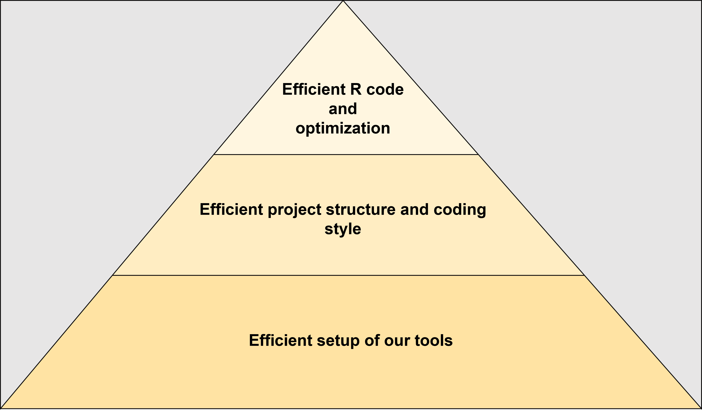
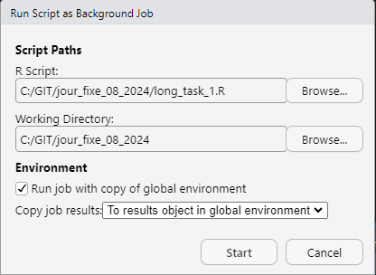
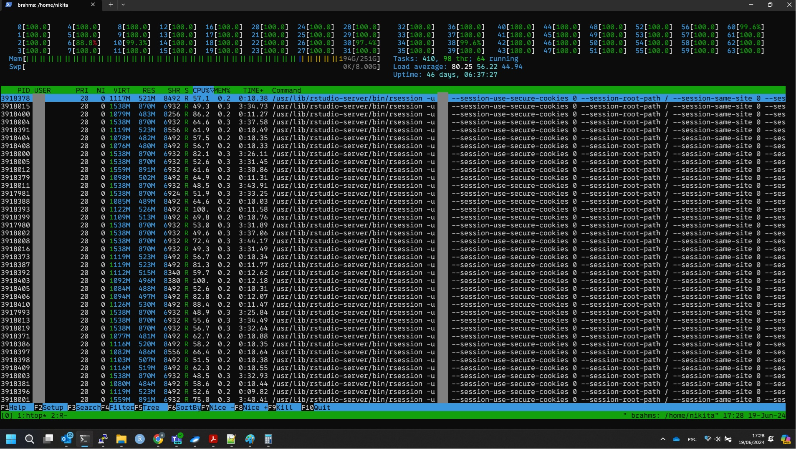
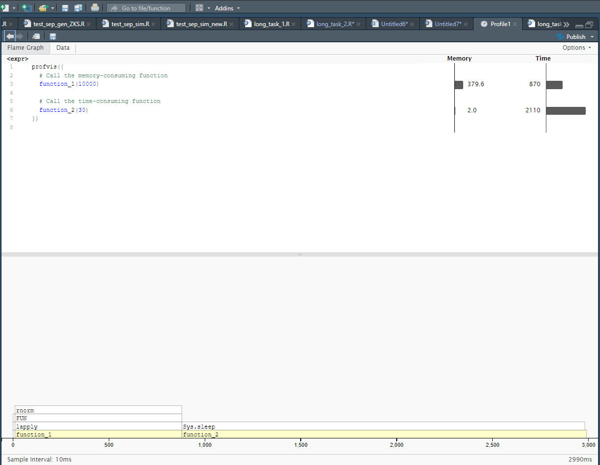

::: {.callout-note appearance="minimal"}
I prepared this for an R session at our group meeting at the MRC Biostatistics Unit. It was first published on the [group's website](https://jourfixe.github.io/posts/August_2024/August2024.html).
:::

## Motivation

Running computationally expensive tasks in R can be challenging, especially when working with **large datasets** and **intensive calculations**. This post provides **practical tips** for efficiently handling background jobs, optimising performance, debugging, and parallelisation.

## Addressing

Efficient execution of computational tasks ensures that R processes run without blocking user interaction, effectively utilising system resources. The pyramid below illustrates the layers of computational efficiency in R programming.

{fig-align="center"}

[Source: Selina Baldauf](https://github.com/selinaZitrone/tools_and_tips/)

------------------------------------------------------------------------

## Running Background Jobs in R

### **Example: Running an Iterative Task in the Background**

Background jobs allow long-running computations\*\* to execute independently, freeing the R console for other tasks.

### **Steps to Run a Background Job in RStudio**

1.  Open RStudio.
2.  Click on “Jobs” → “Start Job” from the RStudio Environment Pane.
3.  Choose “Run Script in Background” and select `script_name.R`.
4.  Monitor progress in the Jobs Pane.

:::::: columns
::: {.column width="55%"}
``` r
library(dplyr)

# Simulate a large dataset
set.seed(123)
large_data <- data.frame(
  id = 1:1e6,
  value = rnorm(1e6)
)

# Perform some computationally intensive operations
for(i in 1:15) {
  result <- large_data %>%
    group_by(id %% 10) %>%
    summarize(mean_value = mean(value))
  Sys.sleep(2) # Simulate long-running process
  cat("Running", i, "iteration.\n")
}

cat("Background job completed.\n")
```
:::

::: {.column width="5%"}
:::

::: {.column width="40%"}
#### 

{.lightbox}
:::
::::::

### **Explanation:**

-   `Sys.sleep(2)` simulates a time-consuming task.
-   Each iteration performs a grouped summary operation.
-   Running this in the background allows users to interact with R without interruption.

------------------------------------------------------------------------

## Responsible Use of Resources

It’s crucial to balance computational demand to prevent overloading shared servers.

**Example:** Most non-HPC servers allow to run small to medium-sized tasks, so large-scale simulations should be managed carefully.

{.lightbox width="1100"}

**Best Practice:**

-   Use resource monitoring tools (`top`, `htop`) to check CPU usage before launching intensive computations.

-   Run long processes inside terminal multiplexers (tmux, screen) to keep jobs running even if the connection is lost.

**🔗 Useful Resources**

📖 [GNU Screen Documentation](https://www.gnu.org/software/screen/manual/screen.html)\
📖 [tmux: Terminal Multiplexer](https://github.com/tmux/tmux/wiki)\
📖 Monitoring System Usage in Linux: [`top` command](https://man7.org/linux/man-pages/man1/top.1.html), [`htop` command](https://htop.dev/)

------------------------------------------------------------------------

# Code Optimisation in R

## Profiling Computational Performance

Optimising R code begins with understanding where time and resources are spent. Profiling helps identify bottlenecks - functions or operations that consume excessive computation time. By analysing execution time, memory usage, and function calls, we can make targeted improvements to enhance efficiency.

### **Why Profiling Matters?**

-   Detects slow functions that need optimisation.\
-   Highlights redundant computations or excessive loops.\
-   Helps determine whether vectorisation or parallelisation could improve performance.\
-   Identifies memory-intensive operations that could cause inefficiencies.

### **Example: Using `profvis()` to Analyse Execution Time**

``` r
library(profvis)

function_1 <- function(size) {
  large_list <- lapply(1:size, function(x) rnorm(5000))
  return(large_list)
}

function_2 <- function(iterations) {
  result <- 0
  for (i in 1:iterations) {
    Sys.sleep(0.1) 
    result <- result + i
  }
  return(result)
}

profvis({
  function_1(10000)
  function_2(30)
})
```

### **Explanation:**

-   `profvis()` visualises where time is spent in an R script.
-   Helps identify slow functions and optimise code for better efficiency.

{.lightbox}

------------------------------------------------------------------------

## Debugging R Code

Writing R code often involves unexpected errors, warnings, or incorrect outputs. Effective debugging strategies help identify issues quickly, saving time and improving code reliability. Debugging tools allow users to step through execution, inspect variable values, and trace errors at runtime.

### **Why Debugging Matters?**

-   Helps locate logic errors and unexpected behavior.\
-   Allows interactive inspection of variables during execution.\
-   Enables tracing of function calls to find where an error originates.\
-   Reduces reliance on excessive `print()` statements for debugging.

### **Common Debugging Techniques in R**

| **Method** | **Use Case** |
|--------------------------------------|----------------------------------|
| `browser()` | Interactive debugging by pausing function execution. |
| `traceback()` | Identifies where an error occurred after execution fails. |
| `debug()` | Step-through debugging for specific functions. |
| `options(error = recover)` | Allows selecting the function frame where an error occurred. |
| `tryCatch()` | Handles errors gracefully without stopping execution. |

### **Example: Using `browser()` for Step-by-Step Debugging**

``` r
foo <- function(x) {
  browser()
  return(x * 2)
}

foo(10)
```

### **Explanation:**

-   `browser()` allows stepwise execution, helping debug unexpected errors.
-   The function pauses at `browser()`, enabling users to inspect variables interactively.


------------------------------------------------------------------------

## Parallelisation in R

Parallel computing significantly reduces execution time by distributing workloads across multiple CPU cores or machines. R provides several parallel computing strategies, each suited for different use cases, from simple parallel loops to high-performance distributed computing.

### **Why Parallelisation Matters?**

-   Reduces execution time for large datasets and simulations.\
-   Utilises multiple CPU cores to improve efficiency.\
-   Allows for distributed computing across clusters or cloud services.

### **Common Parallelisation Strategies in R**

| **Method** | **Use Case** |
|---------------------------------------------|---------------------------|
| `foreach` + `doParallel` | Loops that can be parallelised across CPU cores. |
| `parallel::mclapply()` | Multi-core version of `lapply()` (Linux/macOS only). |
| `future` + `furrr` | Asynchronous parallel computing with flexible backends. |
| `mirai` | High-performance, low-overhead async computing. |

Using the right parallelisation approach depends on the type of computation, hardware resources, and scalability requirements.

------------------------------------------------------------------------

### **Example: Parallelising Loops with `foreach`**

Using parallel computing significantly reduces execution time.

:::::: columns
::: {.column width="45%"}
#### **Regular `for()` Loop**

``` r
result <- NULL

for (i in 1:1000) {
  result[i] <- rnorm(1)^2 
}
```
:::

::: {.column width="5%"}
:::

::: {.column width="50%"}
#### **Parallelised `foreach()` Loop**

``` r
library(foreach)
library(doParallel)

cl <- makeCluster(parallel::detectCores() - 1)
registerDoParallel(cl)

result <- foreach(i = 1:1000, .combine = 'c') %dopar% {
  rnorm(1)^2 
}

stopCluster(cl)
```
:::
::::::

### **Explanation:**

-   Standard `for()` loops execute sequentially, which is slow for large-scale tasks.\
-   `foreach()` with `doParallel` allows parallel execution, using multiple CPU cores.\
-   `makeCluster(parallel::detectCores() - 1)` ensures all but one core are used, preventing system overload.\

**Best Practice:** 

- Always **test code sequentially first** before enabling parallel execution to debug potential issues.\
- Ensure efficient memory usage, as parallel processing may increase RAM consumption.\
- Use `stopCluster(cl)` after parallel execution to release system resources.
- Using `makeCluster(parallel::detectCores() - 1)` may overload the system, especially on shared servers or personal machines, leading to performance degradation for other tasks. Best practice suggests limiting the number of cores to 2 in CRAN package examples and vignettes to ensure compatibility across different systems and prevent excessive resource consumption.

**🔗 Useful Resources**\
📖 [foreach Package Documentation](https://cran.r-project.org/web/packages/foreach/index.html)\
📖 [future Package Documentation](https://cran.r-project.org/web/packages/future/vignettes/future-1-overview.html)\
📖 [mirai: Lightweight Async Computing](https://cran.r-project.org/web/packages/mirai/index.html)\
📖 [Parallel Computing in R Guide](https://cran.r-project.org/web/views/HighPerformanceComputing.html)\
------------------------------------------------------------------------

### **Conclusion**

By implementing these techniques, you can run computational tasks in R more efficiently, reducing runtime and improving workflow performance.