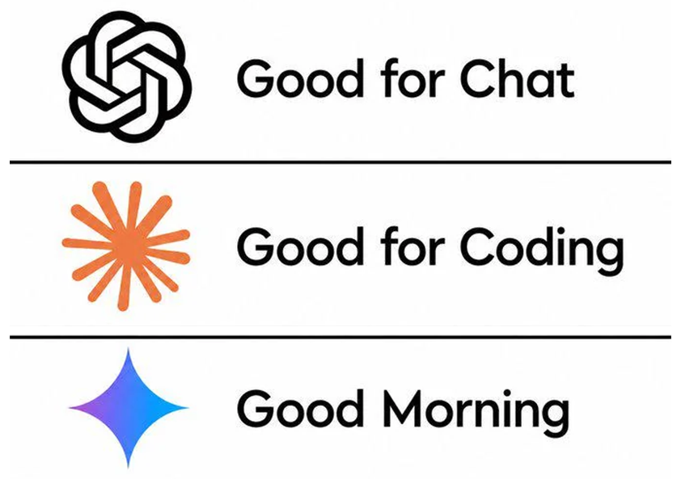
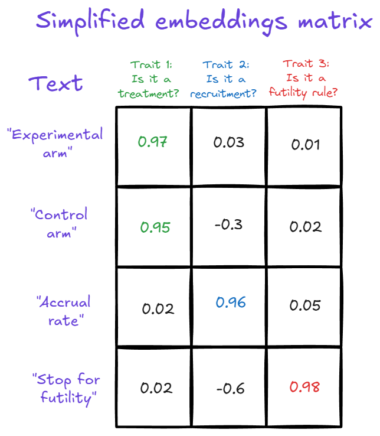
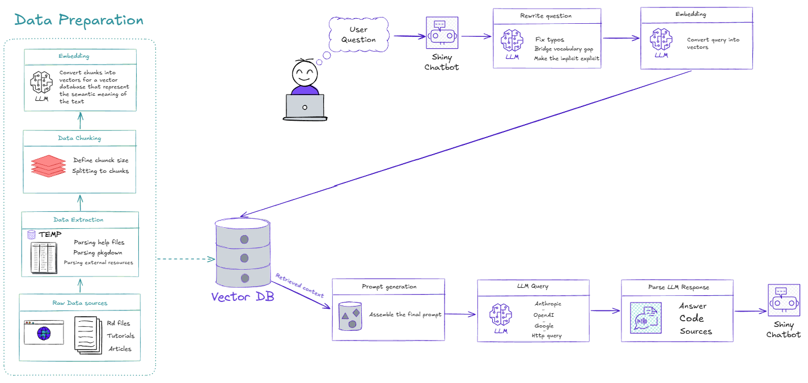
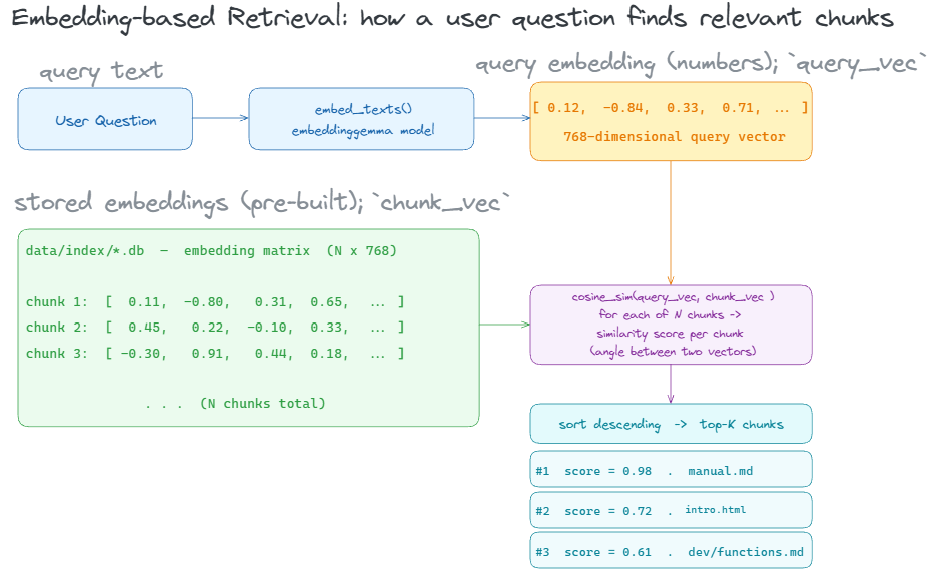
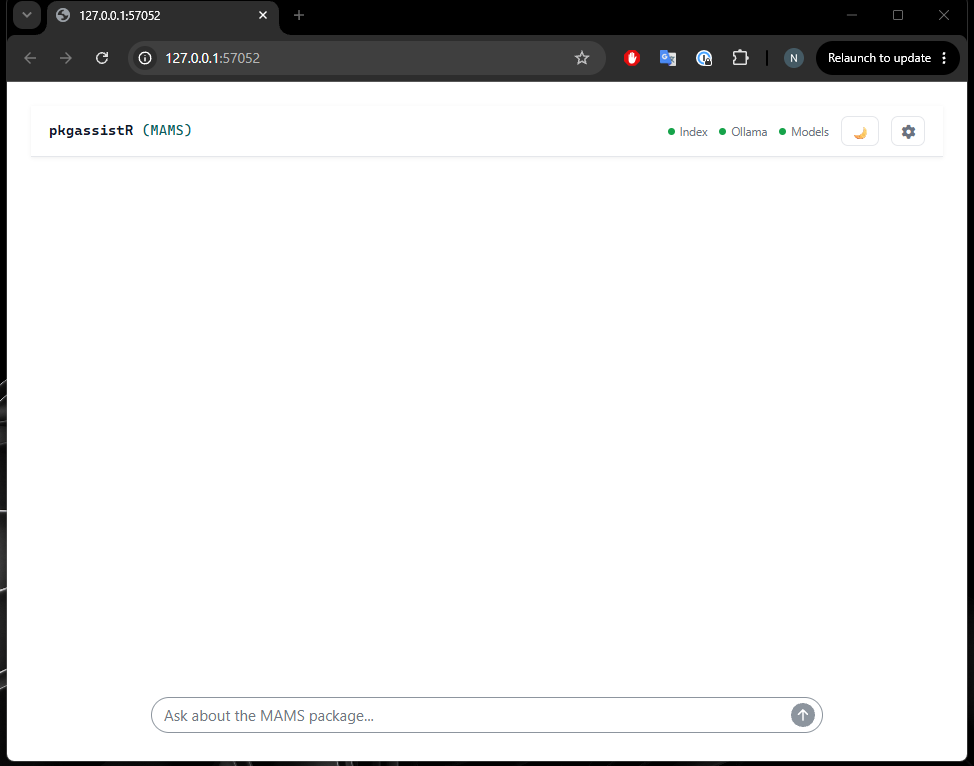
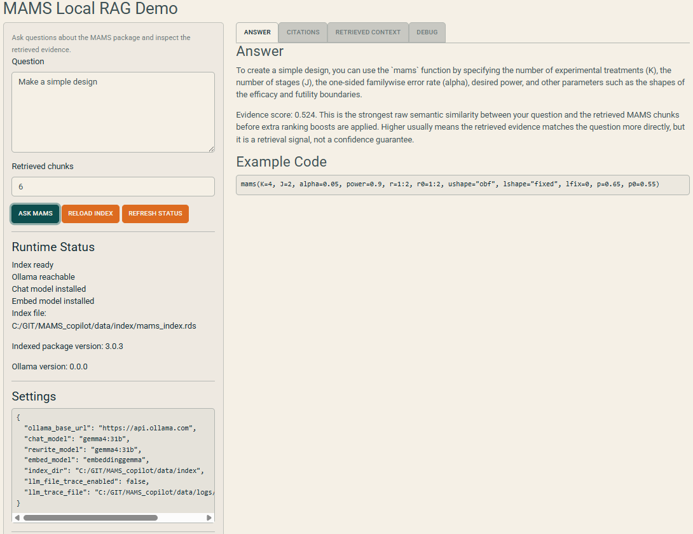
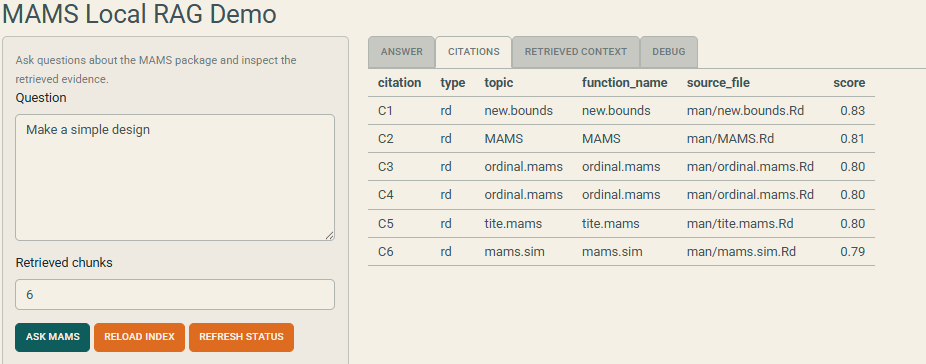
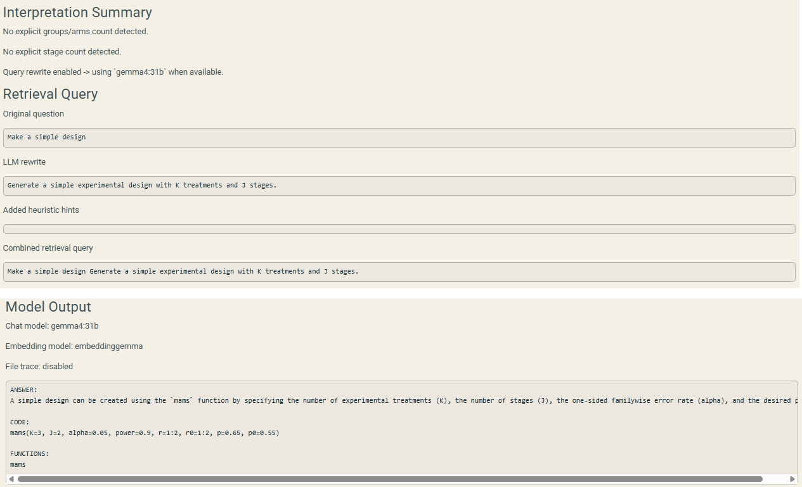

::: {.callout-note appearance="minimal"}
This post is based on a talk I gave at BSU Together at the MRC Biostatistics Unit in July 2026. [Slides (PDF)](BSU-Together-2026-RAG-slides.pdf)
:::

This is about a side project, a side quest in my scientific journey. I built a retrieval-augmented generation (RAG) system around the [MAMS](https://cran.r-project.org/package=MAMS) R package, written entirely in R and running entirely on my laptop.

## AI is everywhere, and it hallucinates

Many people, instead of Googling simple things, now ask an AI model directly. To check how many kilometres there are in one mile, we evaporate an ocean. And very often we hear the question: *what is the best AI model to use?* Frankly speaking, I think we have all been in a situation where every model, whatever its name, hallucinates at us with full confidence.

{fig-alt="Three AI logos: 'Good for Chat', 'Good for Coding', 'Good Morning'." width="55%" fig-align="center"}

There are several ways to make models hallucinate less, and most practical systems combine a few of them:

- Retrieval-augmented generation (RAG), the topic of this post: give the model a curated, relevant context to answer from.
- Tool use, or function calling. This is fairly recent: the model can call functions to check its input, do calculations or run checks before it answers.
- Calibration and fine-tuning, which adapt a model to a specific field. It works, but it takes time, computing power and skill, and it is only possible with open-weight models.

## How RAG works

A RAG system starts with a corpus of documents, the knowledge base that will supply context for future requests. The documents are converted into embeddings and stored, usually in a vector database. When a user asks a question, the question goes through the same embedding step, a similarity search finds the top *K* most relevant chunks, and those chunks are sent to the LLM together with the question. Ideally the model then answers from the supplied context alone: no web search, no other knowledge base, and as little of its internal knowledge as possible.

.](images/rag-architecture.png){fig-alt="Diagram: documents are embedded and stored in a vector database; a user question is embedded, a similarity search finds the top-k matches, and the context plus question go to the LLM, which returns the answer." width="80%" fig-align="center"}

### A detour: what is an embedding?

Take some terms from clinical trials: *experimental arm*, *control arm*, *accrual rate*, *stop for futility*.

Older approaches to text analysis, such as lexicon-based content analysis, scored words on a single dimension like tonality. But "experimental arm" is neither a good-feeling nor a bad-feeling word, and a single score says nothing about its topic or context. Doing better needed complicated models and a lot of manual checking.

An embedding represents each piece of text as a vector of weights across many dimensions of meaning. Conceptually:

{fig-alt="Matrix with rows experimental arm, control arm, accrual rate, stop for futility and columns: is it a treatment, is it recruitment, is it a futility rule. Experimental arm scores 0.97 on treatment; accrual rate 0.96 on recruitment; stop for futility 0.98 on futility rule." width="55%" fig-align="center"}

Is *experimental arm* about treatment? Very much, say 0.97. Is it about recruitment? Only slightly, 0.03. A value can even be negative when the meaning is opposite: *stop for efficacy* could score below zero on a futility dimension, because it is the opposite reason for stopping a trial. A real embedding model has hundreds of such dimensions, and one row for every piece of text.

## From idea to recipe

Almost anything can be the corpus: your own articles, a wiki, finished projects. So I wondered whether the same could be done for an R package.

It can. Here is the scheme I came up with. It has two stages: preparing the data (left) and answering a question (right).

{fig-alt="Diagram. Left: raw sources (Rd files, vignettes, articles) go through extraction, chunking and embedding into a vector database. Right: the user's question is rewritten by an LLM, embedded, matched against the database, assembled into a prompt, sent to an LLM, and the parsed answer is shown in the Shiny chat."}

### Stage 1: preparing the data

An R package can't be dropped into a RAG system as it is, so I start from the raw sources: the package tarball from CRAN, or, since it is our package, the source tree. The useful material is in the `Rd` files (functions, arguments, examples), the vignettes and the package website.

The pipeline:

1. Extract the content from R code, examples, Markdown and HTML into one common form.
2. Split it into chunks. The chunk size is a design decision: a sentence, a paragraph or a whole document, depending on what you need.
3. Embed the chunks, turning each into a vector.
4. Store the vectors next to the original text, as an index for retrieval.

### Stage 2: retrieval and response

When a user asks a question, I added one step before anything else: an LLM rewrites the question. I make a lot of typos, so I let a model fix them, bridge differences in vocabulary and spell out what the user left implicit. Many systems do something like this behind the scenes; I made it a separate step that I can inspect.

{fig-alt="Diagram: user question, embed_texts with the embeddinggemma model, a 768-dimensional query vector; stored chunk embeddings; cosine similarity for each chunk; sort descending and keep top-k chunks with their scores and source files." width="85%" fig-align="center"}

The rewritten question is embedded, a similarity search retrieves the relevant chunks, a prompt is built from the context and the question, and the whole thing goes to an LLM. Any provider works: Anthropic, OpenAI, Google or a local model. Finally, the response, which can contain code, text, links and function names, is parsed and shown in the chat window.

## The ingredients

Everything here is R:

| Step | Package or tool |
|---|---|
| *Data preparation* | |
| Corpus source | CRAN (package tarball) |
| Parsing sources | base R + tidyverse |
| Chunking | my own code (base R + tidyverse) |
| Embeddings | `rollama` (local Ollama, EmbeddingGemma) |
| Storage | plain RDS file (base R) |
| *Retrieval and response* | |
| Retrieval scoring | `dplyr`, `purrr` (embedding similarity) |
| Prompt assembly | my own R script |
| LLM chat | `rollama` (local Ollama), `httr2` (Ollama Cloud), `ellmer` (OpenAI, Anthropic, Google) |
| Interface | `shiny` + `shinychat` |

Two choices are worth a comment. For embeddings I use EmbeddingGemma through `rollama`. It is a very small model, about one gigabyte of memory, and very fast. And I did not use a real vector database: for a corpus this size, an RDS file read with base R is enough.

## The demo: chatting with MAMS

The target package was [MAMS](https://cran.r-project.org/package=MAMS), which designs multi-arm multi-stage clinical trials. The interface is a plain Shiny app with one input box that says *"Ask about the MAMS package."*

{fig-alt="Browser window with a Shiny app titled pkgassistR (MAMS), status lights for index, Ollama and models, and an empty chat with the input 'Ask about the MAMS package...'." width="70%" fig-align="center"}

Some example questions:

- *"Make a simple design."* With no other context, the system explains that a simple design is created with the `mams()` function. It describes the main arguments: the number of experimental treatments `K`, the number of stages `J`, the familywise error rate `alpha` and the desired power. Then it gives example code you can paste straight into R.
- *"How do I create a design with uneven allocation?"* It explains that allocation ratios are set with the `r` and `r0` arguments, gives an example and cites its sources.
- *"How do I run simulations?"* It says which function to use: first create a design object, then simulate from it. Again there is commented code, and the sources are the simulation help page and the package README. Very helpful. Very simple.
- *"Who wrote Hamlet?"* The model replies that it has no information about who wrote Hamlet. A shame, but the right answer. *"Who wrote this package?"* works fine, and frankly that is the more important question here.

Everything runs locally: the embedding model, the response model and the Shiny app all sit on one laptop, and answers take a few seconds. No information leaves the machine and no internet connection is needed. I can use it on a plane, or with information I would not want to send to a remote LLM.

## Under the hood

Early on I built a second Shiny app for debugging and logging, and it turned out to be one of the most useful parts of the system.

{fig-alt="Shiny app 'MAMS Local RAG Demo' with a question box containing 'Make a simple design', a retrieved-chunks setting, runtime status and settings on the left, and the answer with example mams() code on the right." width="80%" fig-align="center"}

With it I can:

- Tune retrieval. The number of chunks to retrieve (top *K*) is adjustable; I usually use between five and ten, depending on the topic.
- See the runtime status: which package is indexed, which models are active (Gemma 3 4B for answers and rewriting, EmbeddingGemma for embeddings) and where the index is stored.
- Inspect the retrieved chunks. For each one I see its topic (in practice the help-page name), the source file and the score.

  {fig-alt="Citations table with six chunks C1 to C6, each with type rd, topic, function name, source file such as man/new.bounds.Rd and man/MAMS.Rd, and scores from 0.83 to 0.79."}

- Trace the pipeline. A debug tab shows every stage. For "Make a simple design", for example, the system notices that no number of arms or stages was given, and the rewrite model turns the question into something like *"Can you create a simple experimental design with K treatments and J stages?"* before retrieval.

  {fig-alt="Debug panel. Interpretation summary: no explicit arms or stages detected, query rewrite enabled. Retrieval query: original 'Make a simple design', rewrite 'Generate a simple experimental design with K treatments and J stages'. Model output with answer, code mams(K=3, J=2, ...) and functions."}

The scoring reflects preferences I set myself. Vignette content ranks above help files, because vignettes carry more context. Chunks also get a bonus when arguments match exactly: ask for a design with `K = 4`, and a chunk containing `K = 4` scores higher. Is this the best possible scoring? Probably not. I tried alternatives, and this one works well enough for what I need. It can be improved later.

## Why bother?

I had two goals. The first, honestly, was to build a RAG system myself from start to finish. The second runs through most of my work: making new and complicated statistical methods usable.

For MAMS we already do the usual things: a vignette, a website, short courses, regular updates to the package and its documentation. Still, I think it is not enough. We can do better. People do not read documentation anymore. They do not read help files. Even a one-page vignette is read by a small share of users; it is easier to ask ChatGPT, Gemini or Claude.

We can't stop people from using general AI tools. We can build a tool that gives more correct answers and is updated much faster than any model's training data. If we add a new function to the package today, a general model knows nothing about it, because it came after the model's knowledge cut-off. With RAG, users get current information straight away.

## RAG on almost everything

So what do I want to say at the end? RAG is not perfect. It is not perfect at all, and it can make mistakes. But often, when we give the model a narrower and more relevant context, it hallucinates less. It can also be combined with the other strategies; adding tool use, for example running computations to check the model's output, is an obvious next step. And RAG can be used on almost everything:

- A knowledge base of previous research. Put a hundred articles in a folder and ask who has covered a topic and who has not, without building an enormous prompt by hand. Putting a whole collection into one huge context is not always the best solution: the larger and less focused the context, the harder it can be for the model to use it well. RAG retrieves a smaller and more relevant context instead.
- A database of consultancy projects. On project thirty-five, ask "have we ever done a sample-size calculation like this?", and learn that yes, it was project R7, and here is the approach used. This one is just an idea. I am not volunteering to build it. But if you think it is useful, you can.

One lesson from building this: better documentation makes a package better suited to RAG. The system can only retrieve what exists. Clear help pages, worked examples and vignettes are no longer written only for human readers; they are also the raw material for tools like this.

## A pointer: ellmer

If you want to work with LLMs from R, look at [`ellmer`](https://ellmer.tidyverse.org/), maintained by Posit, the company behind RStudio. It is an R interface to many LLM providers: you can generate responses, work with model outputs and build your own agents and tools. If this post made you curious, `ellmer` is a good place to start.
