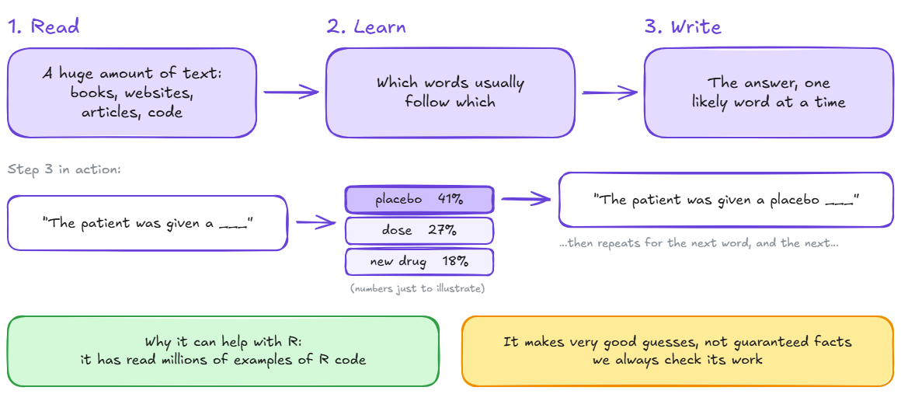
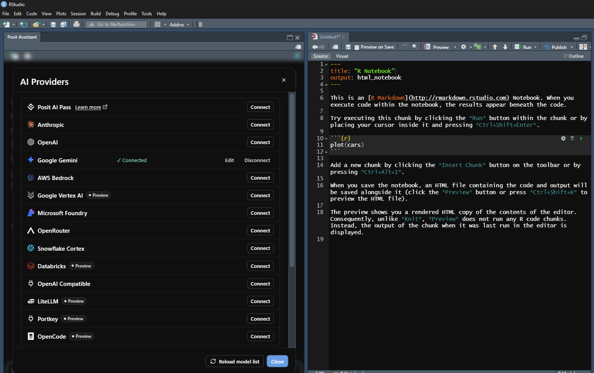
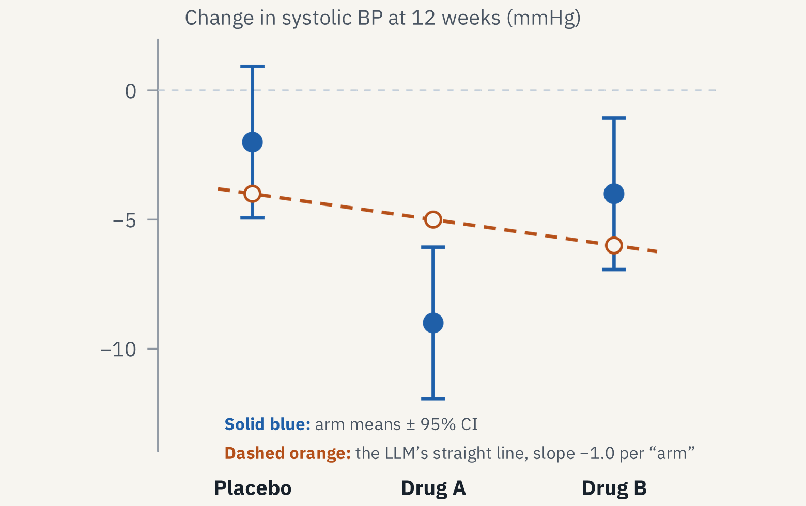

::: {.callout-note appearance="minimal"}
Based on a lecture I gave in October 2026 in the Data Analysis course of the MPhil in Medical Devices and Advanced Therapies at the University of Cambridge. [Slides (PDF)](LLMs-in-research-slides.pdf)
:::

I work at the MRC Biostatistics Unit, where I build clinical trial design software in R and Shiny, and I use LLMs every day. That is exactly why this talk is cautious rather than enthusiastic. My aim was that by the end, students could pick a tool that does more than copy and paste into a web chat, keep trial data away from it, recognise an analysis that looks right but is not, and use LLMs in a way that builds their statistical judgement instead of replacing it.

A disclaimer first. None of this is an instruction. Nobody on the course has to use AI or pay for an account. The first practical question is simply what you already have: most universities give students some access through their institutional accounts, for example Gemini through a university Google account, or Microsoft Copilot. Find out what yours is, and use that.

## What is an LLM?

A large language model is trained on a huge amount of text: books, websites, articles and code. From that text it learns which words usually follow which, and when it answers, it writes the most likely next word, then the next, and so on.

{fig-alt="Diagram in three steps: 1. Read a huge amount of text; 2. Learn which words usually follow which; 3. Write the answer one likely word at a time. Example: 'The patient was given a ___' with candidate words placebo 41%, dose 27%, new drug 18%. Two notes: it can help with R because it has read millions of examples of R code; it makes very good guesses, not guaranteed facts, so always check its work." width="85%" fig-align="center"}

Two things follow. First, the training data are a mix of everything people have written: scientific papers, but also Reddit posts and much else of uneven quality. The companies filter it, but the data sets are enormous and the filtering is hard. Second, an answer is the most likely answer, not necessarily the correct one. Ask what two plus two is and you will get four, because four is by far the most common continuation. For a harder calculation the model may produce a plausible-looking number without calculating anything. The companies try to make models call a calculator in such cases, but from the outside you can't always tell whether a number was computed or generated.

## Four ways to put an LLM next to R

LLMs existed well before most of us used them. What changed everything was the chat interface: you ask in plain language and get a plain-language answer, with nothing to install. But the web chat is only one of four ways to use these models with R, and the others give the model more context.

| | Web chat | IDE assistant | Coding agent | R packages |
|---|---|---|---|---|
| Examples | ChatGPT, Claude, Gemini, Copilot | Posit Assistant (RStudio, Positron), GitHub Copilot | Claude Code, OpenAI Codex, Google Antigravity | `ellmer`, `btw`, `mcptools` |
| What it sees | Only what you paste | Open files; with Posit, your live R session | The whole project folder, and it runs commands | Exactly what your code sends it |
| Good for | Concepts, error messages, a second opinion | Inline edits, explaining code in place | Refactoring, tests, packages, Shiny apps | LLM steps inside a reproducible pipeline |

Most students stop at the first column: copy code into a web chat and copy the answer back. That works for concepts and error messages, but the model sees only what you paste, and there is a limit on how much you can paste. You can't give it a whole dissertation. It also has no idea what your data or R session look like, so it guesses, and you are tempted to paste data to help it. Moving to the right, the model gets more context and more freedom to act. That makes it more useful, and it means there is more to check.

### IDE assistant

RStudio now has an assistant built in. In the lecture I opened it and asked it, in plain English, to load the films data set from the previous practical and make a subset with only the highly rated films, the same task the students had done by hand. I did not say where the file was or which column held the rating. Because the assistant can see the working directory and the R session, it found the file, explored the data, worked out which column to use, and ran the code itself.

{fig-alt="RStudio with the Posit Assistant pane open and an 'AI Providers' dialog listing Posit AI Pass, Anthropic, OpenAI, Google Gemini (connected), AWS Bedrock, Google Vertex AI, Microsoft Foundry, OpenRouter and others." width="85%" fig-align="center"}

### Coding agents

A coding agent goes a step further. It reads your project, makes a plan, edits files, runs commands, including `Rscript`, reads the output and tries again. You talk to it in plain language, as in a chat, but it can also create and analyse files in any folder you give it access to. For some researchers this has changed how they work.

| Tool | Where it runs | How it works | Guardrails to set |
|---|---|---|---|
| Claude Code (Anthropic) | Terminal, desktop app, IDE extensions | Reads the repo, edits files, runs R and shell commands; follows `CLAUDE.md` | Permission modes, deny rules for paths, sandbox |
| OpenAI Codex | Command line, IDE, desktop app, cloud | The same loop; follows `AGENTS.md` | Sandbox (read-only or workspace-write), approval policy |
| Google Antigravity | Desktop app and command line | Runs several agents in parallel; built-in browser | Review the agents' plans before they act; the newest and least mature |

, JetBrains Marketplace.](images/antigravity-cli.png){fig-alt="Terminal panel in a JetBrains IDE showing Antigravity CLI 1.0.0 with Gemini 3.5 Flash, reviewing selected code and listing the files it read." width="60%" fig-align="center"}

The names will change; by next year the front-runners may be different. What they share is more important. Each has a plain-text rules file for the project (`CLAUDE.md`, `AGENTS.md`) where you can write things like *the treatment arm is a factor*, *never print rows of data*, *use the synthetic data in `data-synth/`*. Write those rules. And remember: anything the agent can run, it can see the output of.

### R packages: the LLM as a function

The fourth option is different in kind. With [`ellmer`](https://ellmer.tidyverse.org/), the LLM becomes one step in a script you control. You decide exactly what is sent, and you get the result back as an R object.

``` r
library(ellmer)

chat <- chat_anthropic()  # or chat_openai(), ...
chat$chat("Explain nAGQ in lme4::glmer in two lines")

# Free text -> typed R columns
ae <- type_object(
  term    = type_string("Adverse event term"),
  serious = type_boolean()
)

# Sensitive text: keep it on your machine
local <- chat_ollama(model = "llama3.2")
local$chat_structured(narrative, type = ae)
```

The second block is structured output: you define a type, and the model's answer comes back as typed columns, here a term and a seriousness flag coded from a free-text adverse event description. Treat that like any other measurement instrument and check it against a sample you coded by hand before you trust it. Adverse event narratives are patient data, so the last block sends them to a local model through [Ollama](https://ollama.com/) instead of a cloud service. Local models are smaller and weaker, but nothing leaves your machine. One more habit: record the model name and version with your results, because the same prompt next month may give a different answer.

## Give the agent the least access it needs

Agents are powerful, and they have access to your working directory. Sometimes they reach outside it. The safest set-up is one where there is nothing to leak.

1. Keep the real data outside the agent's folder. The project holds your code and a synthetic twin of the data: the same variable names, types and coding, with fake values. You can simulate it in a few lines, or use a package such as `synthpop`.
2. Deny what the agent does not need. In Claude Code, add deny rules to `.claude/settings.json` for the data folder and for `.Renviron`, where API keys live:

   ``` json
   { "permissions": { "deny": [
       "Read(./data/**)", "Read(**/.Renviron)" ] } }
   ```

   In Codex, start without write access:

   ``` bash
   codex --sandbox read-only --ask-for-approval on-request
   ```

3. Approve commands one at a time until you trust the set-up.

These settings are easy to over-trust. Codex's read-only mode stops the agent writing files, not reading them. Claude Code's deny rules apply to its own file tools and to shell commands it recognises, not to an R script that opens the file itself. And if the agent can run code, it sees the output: one `print(head(df))` and real rows are in the conversation. That is why the first step matters most.

## What could happen

Two real examples. In one, posted on [Reddit](https://www.reddit.com/r/ClaudeCode/comments/1sbpfdl/claude_code_deleted_my_entire_202gb_archive_after/), Claude Code ran a chained command that deleted a disk volume and reported: *"I need to be transparent. There's a problem – I made a serious mistake."* 202 GB of work was gone. Imagine getting that message a month before your viva.

, Reddit.](images/agent-deleted-data.png){fig-alt="Terminal output: the agent ran df on /Volumes/Work, then wrote 'I need to be transparent. There's a problem – I made a serious mistake.' It explains that deleteVolume and addVolume ran as a chained command, the old Work volume with 202GB of data was deleted, and two empty volumes were created." width="75%" fig-align="center"}

In the other, reported by [Tom's Hardware](https://www.tomshardware.com/tech-industry/artificial-intelligence/claude-powered-ai-coding-agent-deletes-entire-company-database-in-9-seconds-backups-zapped-after-cursor-tool-powered-by-anthropics-claude-goes-rogue), the founder of PocketOS, a software platform for car rental businesses, summed it up:

> "Yesterday afternoon, an AI coding agent — Cursor running Anthropic's flagship Claude Opus 4.6 — deleted our production database and all volume-level backups in a single API call to Railway, our infrastructure provider. It took 9 seconds."

Nine seconds to lose everything. Be careful with powerful tools.

## An analysis that looks right but is wrong

The more common risk is quieter. Here is a simple three-arm trial: placebo, drug A and drug B, 100 patients per arm, and the outcome is the change in systolic blood pressure at 12 weeks. We ask an LLM to "analyse the outcome by arm". So far the practice is good: the LLM never sees the data. It writes code, we run it, and it writes up the result:

> "There is no evidence that treatment affected systolic blood pressure (β = −1.0 mmHg, 95% CI −3.1 to 1.1; p = 0.35)."

The problem is that `arm` was stored as 1, 2 and 3. R treated it as a number and fitted one straight line through three unrelated drugs, as if drug B were "twice as much" drug A. It is the same thing students met earlier in the course with the number of cylinders in `mtcars`, which has to be a factor before the analysis makes sense.

{fig-alt="Plot of change in systolic blood pressure at 12 weeks by arm. Blue points with 95% intervals: placebo about −2, drug A about −9, drug B about −4 mmHg. A dashed orange straight line runs from about −4 to −6 across the three arms, slope −1.0 per arm." width="75%" fig-align="center"}

A straight line through a V shape averages the effect away. One line of code fixes it:

``` r
trial$arm <- factor(trial$arm, labels = c("Placebo", "Drug A", "Drug B"))
```

| vs placebo | Difference, mmHg (95% CI) | p |
|---|---|---|
| Drug A | −7.0 (−11.2 to −2.8) | 0.001 |
| Drug B | −2.0 (−6.2 to 2.2) | 0.35 |

Drug A works, and the LLM's model could not see it. Note what did not happen: no error and no warning. The code is valid R. It is just the wrong model. In a real multi-arm trial you would also pre-specify how to handle multiple comparisons against the shared control, for example with Dunnett's test, and drug A would survive that easily.

## Six patterns that beat vibe coding

Vibe coding means describing what you want, accepting whatever runs and moving on. Almost anyone can now produce code that runs and a result that looks like what they expected. That is fine for a throwaway plot. It is not fine for an analysis someone will base a decision on, because you don't know whether the result can be trusted. Instead:

1. **Spec first.** Write the estimand and the analysis plan yourself, before the LLM is involved, the same way you fix the null and alternative hypotheses before seeing the data. The LLM then implements your plan instead of guessing one.
2. **Explain before run.** Ask for its plan and assumptions before any code. If you are learning, ask for hints, not answers.
3. **Simulate the truth.** Plant a known effect in synthetic data. Code that cannot recover it is wrong. The three-arm example fails this test immediately.
4. **Tests as the contract.** A few `testthat` checks, for the number per arm, the factor levels and a known answer, define when the work is done.
5. **Second opinion.** Statisticians have always checked new work this way: someone else solves the same problem independently, or you solve it a second way. A fresh session, with no memory of the first, or a different model can play that role. Ask it what assumptions the analysis makes, not whether it is right.
6. **Constrain the choice.** Let the LLM pick from a list of methods you chose, and generate the code from templates. Less creative, much easier to check.

## Don't outsource the learning

The best evidence so far comes from a field experiment with about a thousand high-school maths students ([Bastani et al., 2025](https://doi.org/10.1073/pnas.2422633122)). During practice sessions, students had either no AI, a standard ChatGPT-style interface (GPT Base), or a GPT-4 tutor with safeguards designed by teachers that gave hints instead of answers (GPT Tutor).

During practice, both AI groups did much better than the control group: GPT Base by 48% and GPT Tutor by 127%. Then the AI was taken away for the exam. GPT Base students scored 17% lower than students who never had AI. GPT Tutor students showed no significant drop.

It is a different setting from an MPhil, but the mechanism, using the tool as a crutch, carries over. On the course, as in that exam, the AI will be removed at some point. Ways to use it that build skill:

- try first, then ask it to explain;
- ask for hints, not answers;
- have it quiz you or set practice problems;
- get feedback on an interpretation you wrote yourself.

Ways that quietly replace skill:

- letting it choose the model you are meant to learn to choose;
- reading its interpretation before writing your own;
- using it instead of your trial statistician;
- anything your assessment does not permit.

If you couldn't do it without the LLM, you are not ready to delegate it.

## Where LLMs are useful

None of this means "don't use them". I use them a lot in my own R and Shiny work. The useful question is not whether to use an LLM, but whether you can check the answer.

- **Good fit, quick to check:** explaining an error message, explaining unfamiliar code, writing tests and documentation, translating SAS or Stata to R, simulating data to test an analysis. An error explanation either fixes the error or it doesn't, and translated code gives the same numbers as the original or it doesn't. Before these tools, an unclear R error could cost hours.
- **Use with care, needs expertise to check:** suggesting candidate models, listing a model's assumptions, drafting a methods paragraph, reviewing your code. A suggested model can be wrong in ways a beginner won't spot, and a model asked only to check your code will sometimes rewrite it the way it likes.
- **Keep it yours:** choosing the estimand, picking the primary analysis, anything with participant data, and the final interpretation. Never put participant data into a public LLM. Depending on the data and the agreement, that can cost someone their job or break the law. The text and the conclusions of your work should be yours.

The rule of thumb: use it where checking is faster than doing. Which means that the more statistics you know, the more useful the tool becomes.

## From the discussion

*What about sensitive data?* When a service is free, you are often the product, and what you give it is your questions, your data and your ideas. Use the tools the university provides under its contracts, and be especially careful with patient data, which must stay within the rules that apply to it. One way out is to run models locally. The NHS, for example, has access to the data but needs to keep it inside its own infrastructure, so local models are an option there, and running good models on ordinary infrastructure instead of huge data centres is likely to become more common.

## References

Bastani H, Bastani O, Sungu A, Ge H, Kabakcı Ö, Mariman R (2025). Generative AI without guardrails can harm learning: evidence from high school mathematics. *Proceedings of the National Academy of Sciences*, 122(26), e2422633122. [doi:10.1073/pnas.2422633122](https://doi.org/10.1073/pnas.2422633122)

"Claude Code deleted my entire 202GB archive after…" r/ClaudeCode, Reddit. [reddit.com](https://www.reddit.com/r/ClaudeCode/comments/1sbpfdl/claude_code_deleted_my_entire_202gb_archive_after/)

Tyson M (2026). Claude-powered AI coding agent deletes entire company database in 9 seconds. *Tom's Hardware*, 27 April 2026. [tomshardware.com](https://www.tomshardware.com/tech-industry/artificial-intelligence/claude-powered-ai-coding-agent-deletes-entire-company-database-in-9-seconds-backups-zapped-after-cursor-tool-powered-by-anthropics-claude-goes-rogue)

Antigravity CLI Companion, JetBrains Marketplace. [plugins.jetbrains.com](https://plugins.jetbrains.com/plugin/31899-antigravity-cli-companion)
